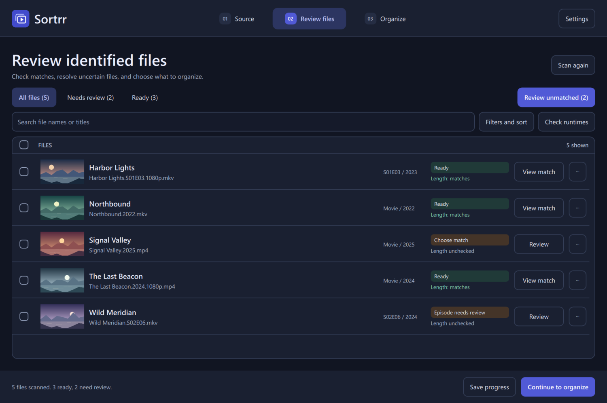
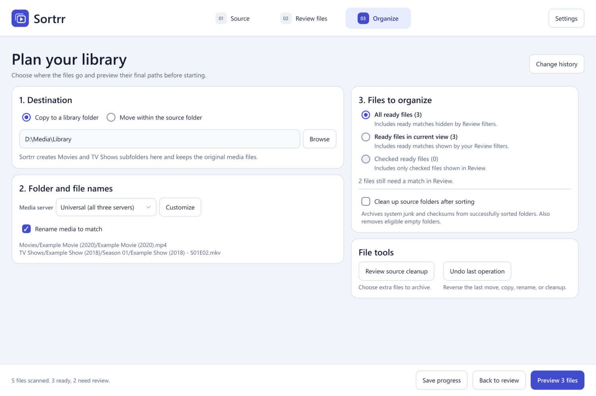
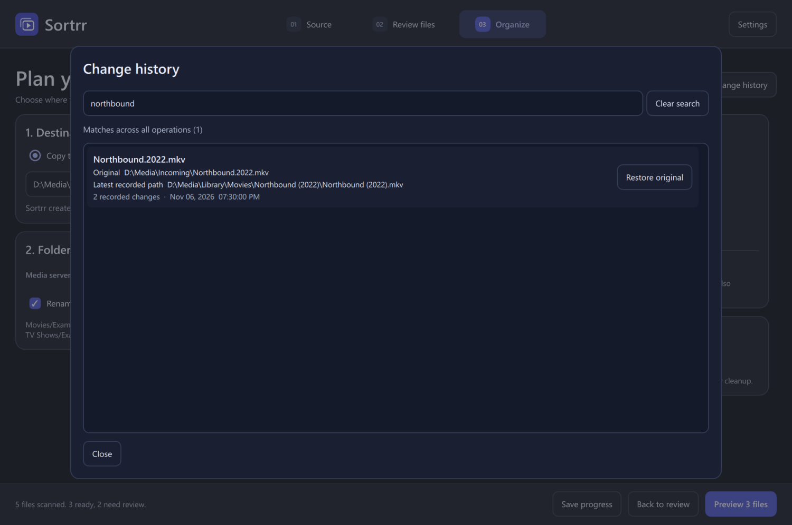

# 

Sortrr identifies movies and TV episodes and organizes them for Plex, Jellyfin, and Emby. It runs locally on Windows.

> **Release Candidate 1.** Sortrr is still in testing. Use a small set of test files or a backed-up library before moving, renaming, or cleaning up media.

[Download the Windows release](https://github.com/technicallyalex/Sortrr/releases)

## Features

- Identify files using TMDb and TVmaze. Review uncertain matches with video previews or enter a match manually.
- Copy or move files using media server presets. Rename media and carry matching subtitles along.
- Review source cleanup, handle rejected files, and save your place between sessions.
- Search change history by file name or path and restore a file to its original name and folder.

## Requirements

- 64-bit Windows. The portable build includes Python, Qt, and FFmpeg.
- Internet access for database lookups. For movies, add a [TMDb API Read Access Token](https://www.themoviedb.org/settings/api) in **Settings → TMDb connection**. TV lookups use TVmaze.

## Quick start

1. Extract the Windows ZIP and open **Sortrr.exe**. Keep the `_internal` folder beside it.
2. In **Source**, choose a media folder and click **Scan files**.
3. In **Review files**, check matches and resolve uncertain results.
4. In **Organize**, choose copy or move and a media server preset. Preview the plan before applying it.
5. Point your media server at the resulting **Movies** and **TV Shows** folders as separate libraries.

## Screenshots

Organize and Change history

This product uses the TMDb API but is not endorsed or certified by TMDb. TV data comes from [TVmaze](https://www.tvmaze.com/api) under [CC BY-SA](https://creativecommons.org/licenses/by-sa/4.0/).
